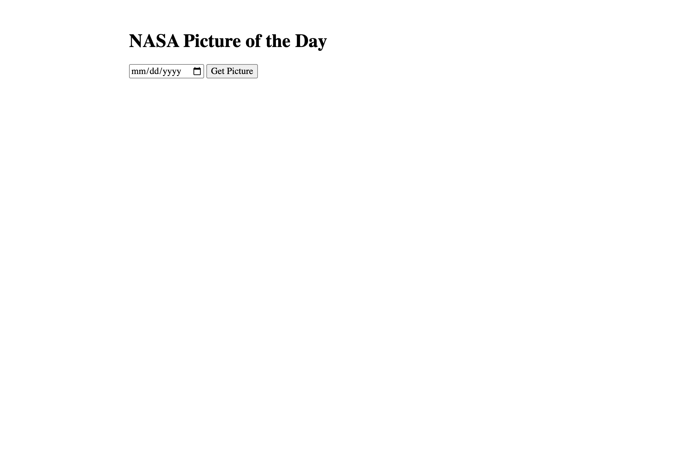

# NASA APOD Explorer

**Explore the universe, one day at a time.**

NASA APOD Explorer is a browser-based application that lets users discover NASA's Astronomy Picture of the Day (APOD) archive through an interactive, date-based experience.

Powered by NASA's APOD API, the application brings astronomical imagery, videos, and accompanying explanations into one accessible interface—making it easy to explore the universe across different dates.

## Live Demo

[Explore NASA APOD](https://simple-nasa-api.netlify.app/)


## Application Preview




## Features

- **Date-Based Exploration:** Select a date to retrieve NASA's Astronomy Picture of the Day.
- **NASA API Integration:** Fetch astronomy content dynamically from NASA's APOD archive.
- **Image & Video Support:** Display astronomical images or embedded videos depending on the API response.
- **Educational Context:** Present the title and NASA's accompanying explanation alongside each entry.

## Tech Stack

| Technology | Purpose |
|------------|---------|
| HTML5 | Application structure and user interface |
| CSS3 | Styling and layout |
| JavaScript | User interactions, API requests, and dynamic content rendering |
| Fetch API | Asynchronous communication with NASA's API |
| NASA APOD API | Astronomy images, videos, and accompanying information |

## Technical Highlights

### API Integration

The application uses JavaScript's Fetch API to retrieve astronomy content based on a user-selected date.

The API response provides the information needed to update the interface dynamically, including the entry's title, explanation, and media.

### Conditional Media Rendering

NASA's APOD API supports multiple media types.

The application checks the response's `media_type` property to determine whether to display an image or embedded video.

For image responses, the application updates an HTML image element. For video responses, it uses an iframe to support embedded media, including YouTube-hosted content.

This approach allows the interface to accommodate different content formats without requiring separate pages.

### Dynamic DOM Updates

The application updates the displayed content using JavaScript, allowing users to explore different dates without reloading the entire page.

## Product Roadmap

The current implementation establishes the foundation for a more immersive astronomy exploration experience.

Potential enhancements include:

- **Improved Search Experience:** Add date validation, loading indicators, and clearer feedback when content is unavailable.
- **Favorites & Collections:** Allow users to save memorable discoveries and revisit them later.
- **Random Discovery:** Introduce a feature that surfaces a randomly selected astronomy entry.
- **Browse & Explore:** Support easier navigation between dates and exploration of past entries.
- **Enhanced Accessibility:** Improve keyboard navigation, media descriptions, and responsive presentation across devices.

These features represent potential future development rather than functionality currently available in the application.


## Getting Started

### Use the Live Application

Visit [NASA APOD Explorer](https://simple-nasa-api.netlify.app/), select a date, and click **Get Picture** to retrieve NASA's astronomy content.

### Run Locally

1. Clone the repository's `answer` branch:

   ```bash
   git clone --branch answer --single-branch https://github.com/BuilderPlayground/simple-nasa-api-bootcamp.git
   ```

2. Navigate to the project directory:

   ```bash
   cd simple-nasa-api-bootcamp
   ```

3. Open the project in VS Code.

4. Launch `index.html` using Live Server.

5. Select a date and click **Get Picture**.


## Project Structure

```text
simple-nasa-api-bootcamp/
├── css/
│   ├── normalize.css
│   ├── reset.css
│   └── style.css
├── js/
│   └── main.js
├── index.html
├── simple-nasa-api-demo-pic.png
└── README.md
```


## Credits & Acknowledgments

Built using the [Resilient Labs starter repository](https://github.com/Resilient-Labs/simple-nasa-api-bootcamp).

Astronomy content is provided by NASA through its [Astronomy Picture of the Day API](https://api.nasa.gov/).
